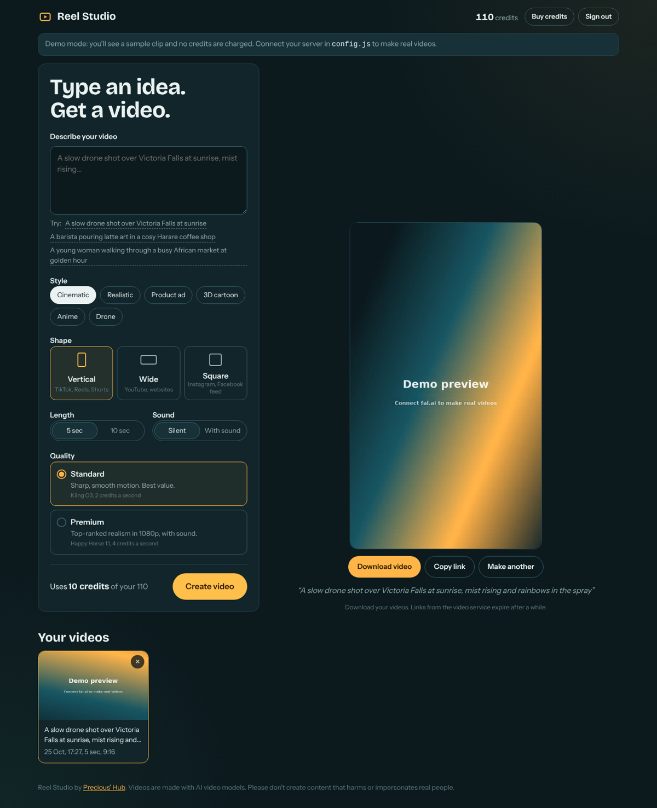

# Reel Studio

**Type an idea, get a video.** Reel Studio turns a short description into an AI-generated video for TikTok, Reels, YouTube or ads, in about 1 to 3 minutes.



## What it does

- **Describe your video** in plain words, or start from an example idea.
- **Pick a style** (cinematic, realistic, product ad, 3D cartoon, anime, drone) and a **shape**: vertical 9:16, wide 16:9 or square.
- **Choose quality:**
  - **Standard** uses Kling O3: sharp, smooth motion at the best price.
  - **Premium** uses Happy Horse 1.1: top-ranked realism in 1080p, with sound.
- **Watch it render** with live queue position and timer, then download it or copy the link.
- **Credits and access codes.** Customers sign in with a code. Each video costs credits, and failed videos are refunded automatically.
- **Admin page** (`?admin`) to create codes for customers and top them up after they pay.
- **Demo mode** runs the whole experience with sample clips before you connect a server.

## How it works

```
Browser (React)  ──►  Your server (Cloudflare Worker)  ──►  fal.ai video models
   prompt, settings        checks code + credits              Kling O3 / Happy Horse 1.1
   polls for status   ◄──  keeps the fal.ai key secret   ◄──  returns the finished video
```

- The **website** never sees your fal.ai key. Every request goes through the worker.
- The **worker** stores access codes, credit balances and jobs in Cloudflare KV, sends jobs to fal.ai's queue, and refunds credits if a video fails.

## Project structure

```
web/                   The website (React + TypeScript + Vite)
  public/config.js     Server address, brand name and WhatsApp number. Edit this to connect.
  src/useStudio.ts     Sign-in, credits, generating and polling
  src/Composer.tsx     The prompt form
  src/Stage.tsx        Preview: waiting, rendering, finished, failed
  src/Admin.tsx        Create and top up access codes
worker/
  worker.js            The server: models, pricing, credits, fal.ai calls
  worker.test.js       Server tests
SETUP.md               Step-by-step setup guide
```

## Tests

```bash
cd worker && npm install && npm test   # 12 server tests: pricing, credits, refunds, security
cd web && npm install && npm test      # website tests in demo mode
```

GitHub Actions runs both on every push and deploys the website to GitHub Pages.

## Changing models or prices

Open `worker/worker.js` and edit `MODELS`. Each model lists its fal.ai endpoint, what fal.ai charges per second, and how many credits you charge per second. By default 1 credit = US$0.10, so a 5-second Standard video costs the customer 10 credits (US$1.00) and costs you about US$0.42.

## Responsible use

fal.ai's safety checker is on for every request. Don't create content that harms, deceives or impersonates real people.

## Author

Built by **Precious Mashawa**, Harare, Zimbabwe. [Portfolio](https://preciousmashawa.co.zw)
